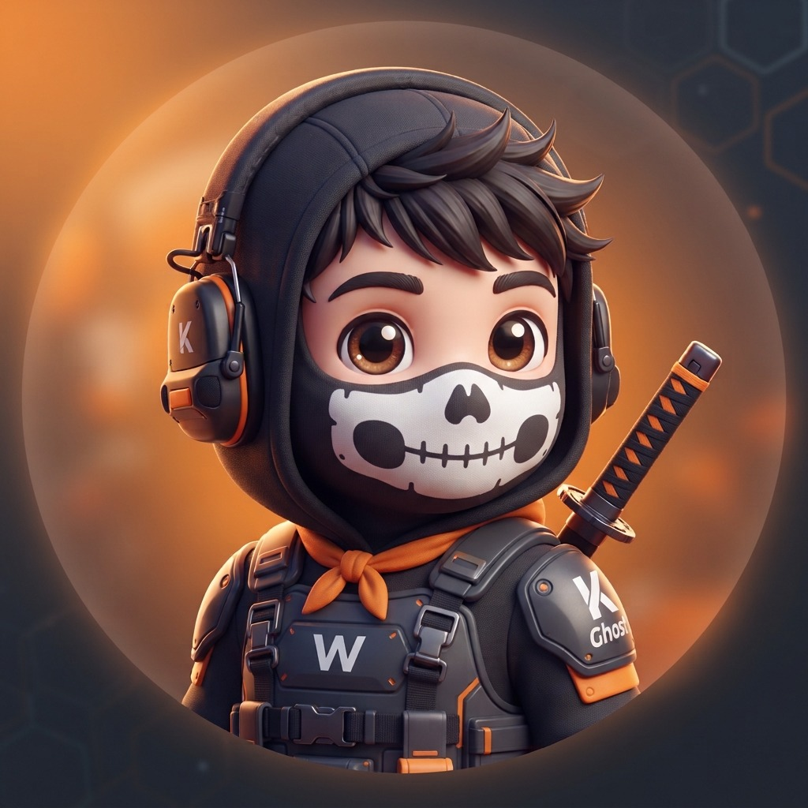

# ⚔️ Ghost Fruit — Lâmina Shinobi & Visão Computacional

<p align="center">
  
</p>

<p align="center">
  <b>Ghost Fruit</b> é uma aplicação web interativa em tempo real inspirada no clássico arcade <i>Fruit Ninja</i>, desenvolvida com <b>Visão Computacional no navegador</b> através do <b>MediaPipe HandLandmarker</b>, <b>React 19</b>, <b>TypeScript</b>, <b>Canvas API</b> e síntese sonora procedural com <b>Web Audio API</b>.
</p>

<p align="center">
  
  
  
  
  
  
</p>

---

## 👨‍💻 Sobre o Projeto

Olá! Eu sou **Wander França** (DEV FullStack & Data Scientist) — você pode conferir minha trajetória e outros projetos no meu [Portfólio Oficial](https://suporteoberon.com.br/wander-franca/). Desenvolvi o **Ghost Fruit** com o objetivo de unir **visão computacional de ponta**, **engenharia de software moderna** e **física de jogos arcade** diretamente no navegador web, sem necessidade de instalar aplicativos nativos ou plugins externos.

No Ghost Fruit, a sua webcam vira o cenário do jogo. Ao posicionar sua mão em frente à câmera e estender o **dedo indicador**, a ponta do seu dedo se torna a ponta de uma **Katana Shinobi**, capaz de fatiar frutas no ar com detecção contínua de colisão (CCD), desaceleração de tempo (Super Chakra), combos acrobáticos e gravação de vídeo em alta definição com áudio sincronizado.

Todo o processamento de Machine Learning roda **100% no dispositivo (client-side)** acelerado por WebGL/GPU, garantindo privacidade absoluta: nenhuma imagem ou frame de vídeo sai do seu aparelho.

---

## ⚡ Principais Funcionalidades

### 1. 🗡️ Rastreamento de Lâmina por Visão Computacional
- **Rastreamento Sub-Milimétrico:** Rastreia a ponta do indicador (*Landmark 8*) a 30-60 FPS via `@mediapipe/tasks-vision`.
- **Filtro Adaptativo 1-Euro (`OneEuroFilter`):** Elimina o tremor residual de iluminação e ruído do sensor quando a mão está parada, ao mesmo tempo em que reage instantaneamente com lag zero a golpes rápidos de corte.
- **Amplificação de Alcance Dinâmico (1.28×):** Permite que jogadores em qualquer proporção de tela — inclusive **monitores Ultra Wide (21:9 e 32:9)** — alcancem 100% da largura da tela sem precisar esticar os braços para fora do campo de visão da webcam.
- **Detecção Contínua de Colisão (CCD):** Teste de interseção por segmento de reta e distância perpendicular mínima. Golpes ultrarrápidos nunca atravessam as frutas sem cortá-las.
- **Corte Instantâneo:** Sem barreira de velocidade mínima — basta encostar o dedo ou o cursor na fruta para ela se partir.

### 2. 🍉 Frutas com Física Balística & Visual Realista
- **Arcos Parabólicos Altos:** Lançamento balístico calculado sob gravidade física ($g = 820\text{ px/s}^2$). As frutas voam alto até o terço superior da tela (12% a 35% do topo), proporcionando tempo de reação ideal e arcos amplos para fatiar.
- **Geometria Dedicada por Fruta:**
  - **Melancia:** Esfera verde 3D com listras escuras sinuosas, brilho esférico e polpa vermelha com sementes expostas no corte.
  - **Maçã:** Silhueta com covinha entalhada, gradiente carmesim, cabinho de madeira e folhinha verde.
  - **Banana:** Curvatura realista em crescente com facetas poligonais e ponta preta.
  - **Laranja:** Textura cítrica porosa, gomos radiais e cálice verde com folha.
  - **Pitaya (Dragonfruit):** Corpo magenta vibrante com escamas de dragão verdes e amarelas saindo para fora.
  - **Carambola (Starfruit):** Estrela geométrica de 5 pontas translúcida com cumes dourados refletivos.
  - **Bomba Armadilha:** Esfera de ferro fundido com pavio fumegante e faíscas crepitantes.

### 3. 🥋 Botões Cortáveis no Ar (`SliceableButton`)
- Botões interativos que podem ser clicados, arrastados ou **fatiados no ar passando o dedo indicador**.
- Física de corte com separação diagonal em duas metades (`clip-path`), rastro incandescente de chakra e explosão de faíscas.
- Efeito sonoro metálico de katana sintetizado em tempo real com latência zero.

### 4. 🎛️ Assistente de Calibração Rápido (15 segundos)
- Orientação de enquadramento e iluminação.
- Seleção de mão ativa (Direita ou Esquerda) com inversão espelhada natural na câmera frontal.
- Teste de estabilidade no alvo central (1 segundo).
- Teste de alcance nos 4 cantos da tela.
- Teste de velocidade da lâmina e treino seguro de corte livre de bombas.
- Recalibração acessível a qualquer momento com um clique.

### 5. 🔊 Motor de Áudio Procedural (Web Audio API)
- **Zero Dependência de Arquivos de Áudio:** Todos os sons são gerados matematicamente por osciladores, filtros biquad e geradores de ruído branco em tempo real.
- Sons de deslocamento de ar (*whoosh*), impacto metálico de katana (*zing*), estalo de polpa, explosão de bombas, sino de combos e ativação do modo Super.

### 6. 🎥 Gravação HD de Partidas (MP4 / WebM)
- **HUD Vetorial Nítido no Vídeo:** Placar, multiplicador de combo, cronômetro e corações renderizados com curvas de Bézier em alta definição, garantindo clareza máxima em 1080p.
- Gravação direta do canvas a 30 FPS via `MediaRecorder`.
- **Áudio Sincronizado sem Cortes:** Sistema de *keep-alive* inaudível que mantém o relógio de áudio fluindo continuamente no container MP4, evitando que o navegador descarte a faixa sonora nos intervalos de silêncio.
- **Mixagem de Microfone Opcional:** Permite gravar sua própria voz/webcam falando e comemorando durante a partida.
- Preview imediato, download nomeado com pontuação e compartilhamento nativo via Web Share API.

### 7. 💼 Modo Apresentação & Portfólio (Split Screen)
- Quando o jogador se chama **Wander França**, a tela ganha uma composição demonstrativa para LinkedIn e portfólio técnico:
  - **Topo:** Jogo ao vivo com lâmina shinobi.
  - **Base Esquerda (30%):** Webcam ao vivo em destaque.
  - **Base Direita (70%):** Cartão de engenharia com competências em FullStack & Data Science, link direto para o portfólio oficial ([suporteoberon.com.br/wander-franca](https://suporteoberon.com.br/wander-franca/)) e stack tecnológica.

---

## 🛠️ Tecnologias Utilizadas

| Tecnologia | Versão | Função no Projeto |
| :--- | :--- | :--- |
| **React** | `19.2.4` | Estrutura declarativa de componentes e hooks de ciclo de vida |
| **TypeScript** | `5.9.3` | Tipagem estática rigorosa para física, colisões e contratos de dados |
| **Vite** | `6.4.1` | Bundler ultrarrápido com Hot Module Replacement (HMR) e suporte HTTPS |
| **@mediapipe/tasks-vision** | `0.10.22` | Pipeline de visão computacional e Hand Landmarker acelerado por GPU |
| **Tailwind CSS** | `3.4.17` | Estilização utilitária moderna e animações responsivas |
| **Canvas API (HTML5 2D)** | Nativo | Renderização gráfica de alto desempenho (60 FPS) de partículas, lâminas e frutas |
| **Web Audio API** | Nativo | Síntese sonora procedural em tempo real |
| **MediaStream & MediaRecorder** | Nativo | Captura de vídeo/áudio combinados e exportação MP4/WebM |
| **Lucide React** | `1.16.0` | Ícones vetoriais da interface |

---

## 🚀 Como Executar o Projeto Localmente

### Pré-requisitos
- **Node.js** (versão 18.x ou superior recomendada)
- **NPM** ou **Yarn** ou **PNPM**
- Um computador com **Webcam** (integrada ou USB) ou smartphone

### 1. Clonar o Repositório
```bash
git clone https://github.com/wanderfranca/ghostfruit.git
cd ghostfruit
```

### 2. Instalar as Dependências
```bash
npm install
```

### 3. Iniciar o Servidor de Desenvolvimento
```bash
npm run dev
```

O terminal exibirá os endereços locais de acesso com suporte **HTTPS**:
```
  VITE v6.4.1  ready in 480 ms

  ➜  Local:   https://localhost:5173/
  ➜  Network: https://192.168.x.x:5173/
```

> **Nota sobre HTTPS e Câmera:**  
> Navegadores modernos exigem conexão segura (HTTPS ou localhost) para conceder acesso à webcam. O projeto utiliza o plugin `@vitejs/plugin-basic-ssl` para gerar certificados de desenvolvimento automáticos. No primeiro acesso, aceite o aviso de certificado autoassinado do seu navegador para liberar a câmera.

### 4. Build para Produção
Para compilar e minificar os assets estáticos para distribuição:
```bash
npm run build
```

Para testar a versão compilada localmente:
```bash
npm run preview
```

---

## 📂 Estrutura de Diretórios

```
ghostfruit/
├── docs/
│   └── screenshots/              # Capturas de tela demonstrativas da aplicação
├── public/
│   ├── icon.svg                  # Ícone vetorial do jogo
│   ├── manifest.webmanifest      # Manifesto PWA instalável
│   ├── mascot.jpg                # Mascote Shinobi oficial
│   ├── sw.js                     # Service Worker PWA offline
│   ├── temple-bg.jpg             # Imagem de fundo do templo
│   ├── models/                   # Modelo local hand_landmarker.task
│   └── wasm/                     # Binários WebAssembly do MediaPipe Vision
├── src/
│   ├── audio/
│   │   └── soundManager.ts       # Síntese sonora procedural Web Audio API
│   ├── camera/
│   │   └── cameraManager.ts      # Gerenciamento de câmera, aspect ratio e projeção
│   ├── components/
│   │   ├── AnimatedTempleBackground.tsx # Fundo animado com partículas de folhas e névoa
│   │   ├── CalibrationWizard.tsx # Assistente de calibração passo a passo
│   │   ├── GameHUD.tsx           # Placar, vidas, tempo, indicador de Super e controles
│   │   ├── GameOverModal.tsx     # Modal de resultados, estatísticas e download do vídeo
│   │   ├── PauseModal.tsx        # Modal de pausa com atalhos de treino
│   │   ├── SettingsModal.tsx     # Configurações de iluminação, suavização facial e áudio
│   │   ├── SliceableButton.tsx   # Botão cortável com física de corte de katana
│   │   └── StartScreen.tsx       # Tela inicial com formulário e modos shinobi
│   ├── engine/
│   │   ├── collision.ts          # Detecção contínua de colisão (CCD) por segmento
│   │   ├── comboTracker.ts       # Rastreamento de combos em tempo real
│   │   ├── gameEngine.ts         # Loop principal, estados, vidas e pontuação
│   │   ├── physics.ts            # Gravidade, rotação e divisão balística
│   │   └── spawner.ts            # Algoritmo de lançamento justo e zonas de ápice
│   ├── recording/
│   │   └── gameRecorder.ts       # Gravação composta de canvas + áudio via MediaRecorder
│   ├── rendering/
│   │   └── canvasRenderer.ts     # Renderizador gráfico Canvas 2D a 60 FPS
│   ├── tracking/
│   │   ├── calibrationManager.ts # Persistência de perfis de calibração no localStorage
│   │   ├── handTracker.ts        # Pipeline MediaPipe e detecção de gestos
│   │   └── oneEuroFilter.ts      # Filtro 1-Euro adaptativo com deadband anti-tremor
│   ├── types/
│   │   └── game.ts               # Contratos e tipos TypeScript do ecossistema
│   ├── App.tsx                   # Orquestrador central e gerenciamento de estado
│   ├── main.tsx                  # Ponto de entrada React
│   └── index.css                 # Configuração do Tailwind CSS
├── vite.config.ts                # Configuração do Vite com suporte HTTPS
├── tsconfig.json                 # Configuração do compilador TypeScript
└── package.json                  # Manifesto de dependências e scripts
```

---

## 🔒 Privacidade e Segurança

- **100% On-Device:** O vídeo da sua webcam é processado exclusivamente na memória RAM e GPU do seu próprio computador ou celular.
- **Nenhum Dado Enviado à Nuvem:** Nenhuma imagem, gravação, métrica facial ou coordenada corporal é transmitida para servidores externos.
- **Gravação Controlada:** Os vídeos gravados ficam restritos à memória temporária do seu navegador (como `Blob` local) e só são salvos se você clicar voluntariamente no botão **"Baixar Vídeo"**.

---

## 👤 Autor

Desenvolvido com dedicação por **Wander França**:

- **Portfólio Oficial:** [suporteoberon.com.br/wander-franca](https://suporteoberon.com.br/wander-franca/)
- **Website:** [suporteoberon.com.br](https://suporteoberon.com.br)
- **GitHub:** [@wanderfranca](https://github.com/wanderfranca)
- **LinkedIn:** [Wander França](https://www.linkedin.com/in/wanderfranca)
- **E-mail:** [contato@suporteoberon.com.br](mailto:contato@suporteoberon.com.br)

---

<p align="center">
  <i>"A maestria de um shinobi está na precisão da lâmina e no controle do chakra." ⚔️🍃</i>
</p>
